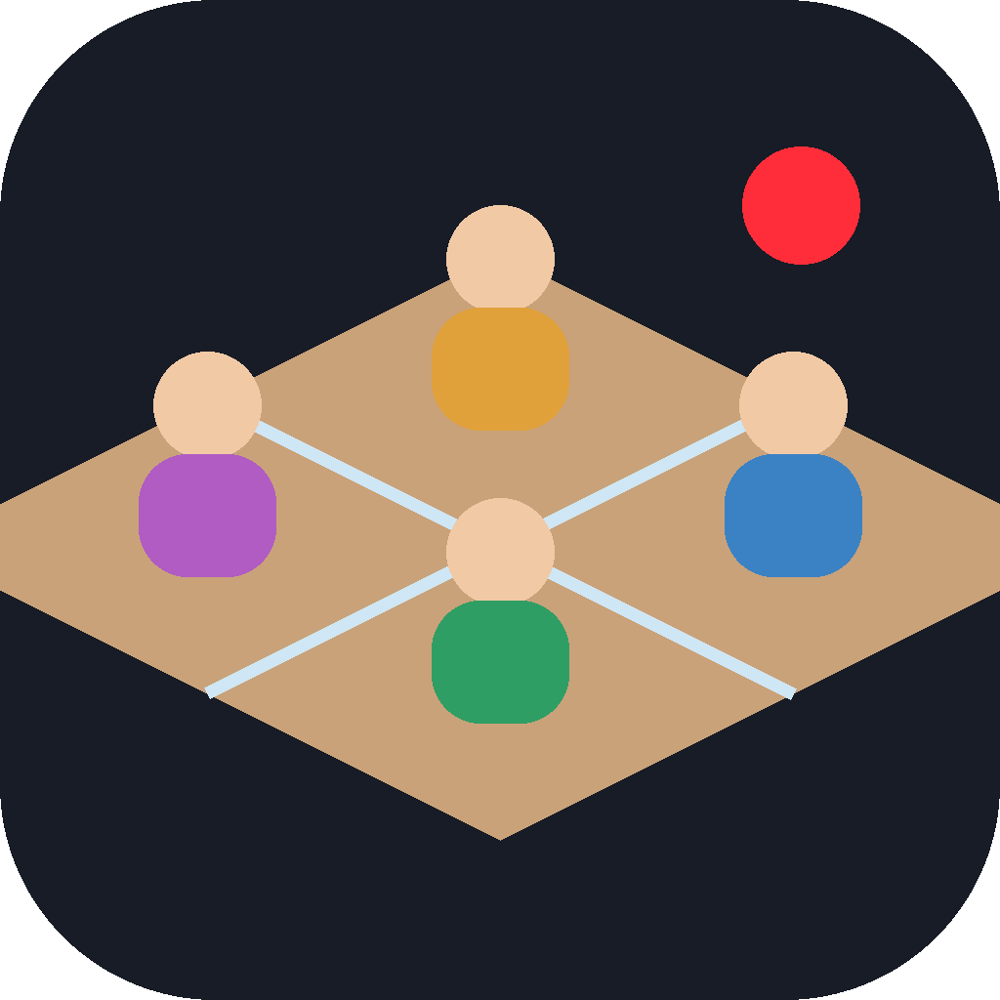
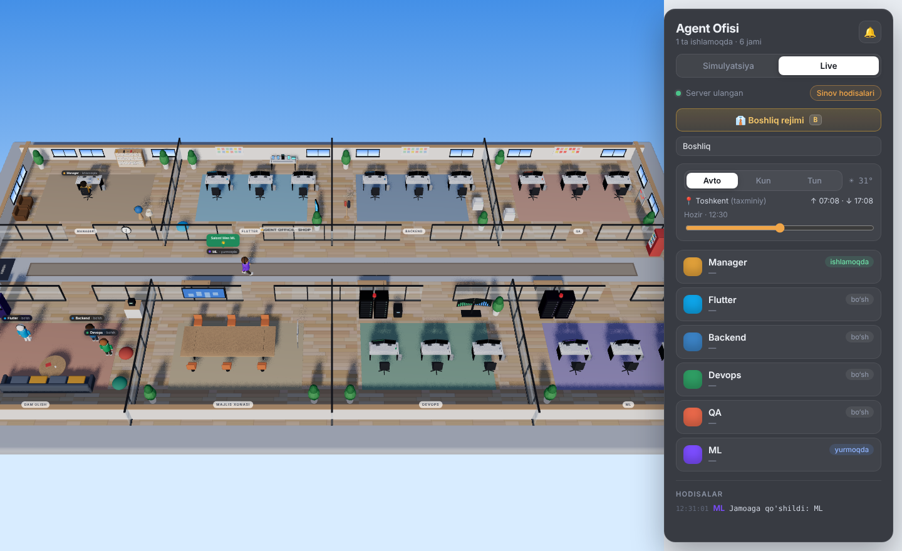
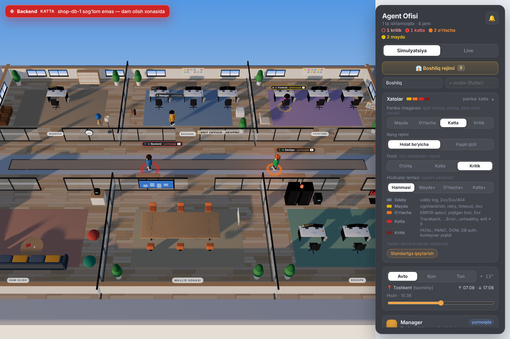
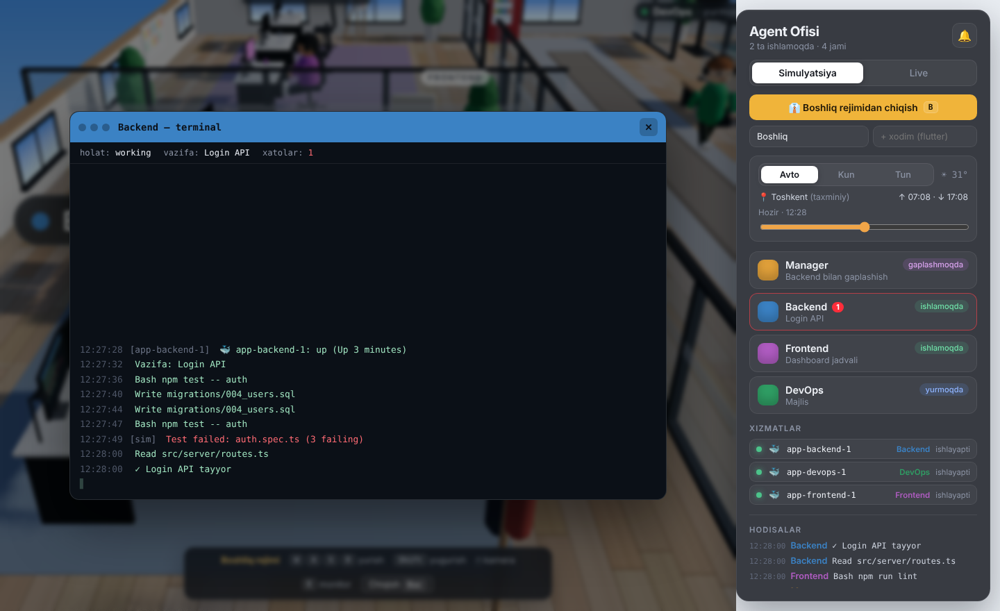
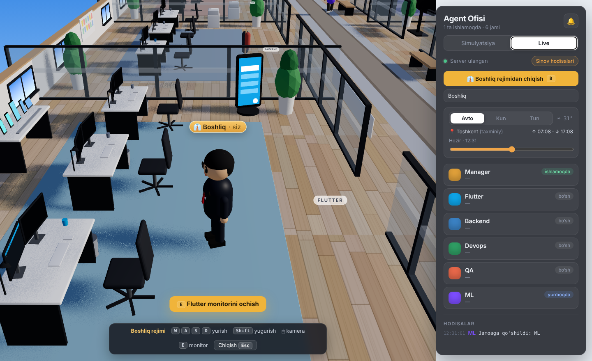
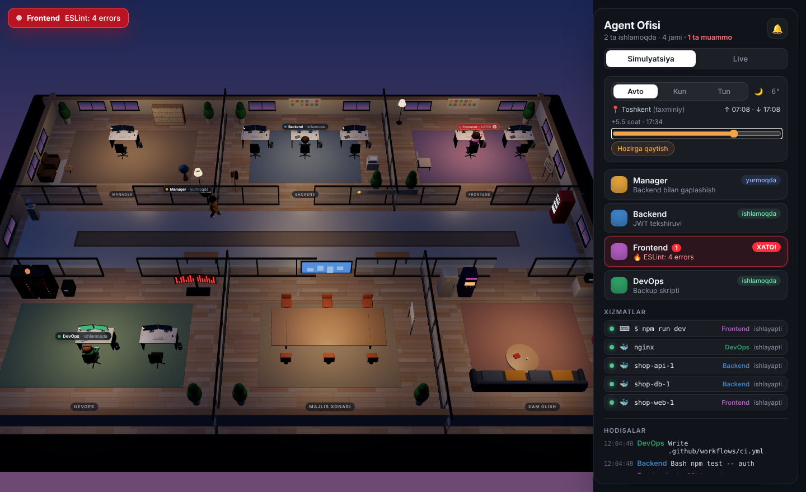

<div align="center">



# Agent Office 3D

**A Claude Code plugin that gives every sub-agent a desk in a 3D office.**
Watch them work, see your containers fail, walk in and read their screens.


[Documentation](https://general009.github.io/Agent-Office/) · [Install](#install) · [O‘zbekcha](#ozbekcha)



</div>

## What it does

- **Every sub-agent gets a room.** When Claude delegates work, the agent walks to its desk and every `Edit`, `Bash` or `Read` shows up as a speech bubble.
- **Your project decides the team.** `/agent-office:setup` reads the repository and creates one agent per area — Flutter, backend, DevOps, QA… The building grows a furnished room for each one.
- **Errors have a severity.** Every log line, failed tool call and container state is graded *minor*, *moderate*, *major* or *critical*. Agents, desks, monitors and lists take that colour, and from the level you choose the agent panics — red alarm light, siren on the server rack, a trip to the lounge. A line that repeats is grouped into one entry with a counter and raised one level.
- **Stopped containers send agents to the lounge.** When a Docker container exits, crash-loops or turns unhealthy, its agent sits on the sofa until the service is back.
- **Boss mode.** Press <kbd>B</kbd>, walk through the office in third person, stand at a desk and press <kbd>E</kbd> to read that agent's terminal.
- **The real sky.** Sunlight, sky colour and office lamps follow the actual sun at your location.

<table>
<tr>
<td width="50%"><br><sub>Error severity: settings and colours by level</sub></td>
<td width="50%"><br><sub>Boss mode: reading the backend agent's terminal</sub></td>
</tr>
<tr>
<td width="50%"><br><sub>The Flutter room, built by <code>/agent-office:setup</code></sub></td>
<td width="50%"><br><sub>Twenty minutes after the real sunset</sub></td>
</tr>
</table>

## Install

You need [Claude Code](https://claude.com/claude-code) and **Node.js 18 or newer**. Nothing else — the server uses only Node's standard library and the 3D interface ships prebuilt.

Inside Claude Code:

```
/plugin install agent-office --marketplace GENERAL009/Agent-Office
```

Or from your terminal:

```bash
claude plugin marketplace add GENERAL009/Agent-Office
claude plugin install agent-office@agent-office
```

## Quick start

1. Open Claude Code in your project:
   ```bash
   cd my-project
   claude
   ```
   The office server starts on its own when the session starts.
2. Run `/agent-office:office` — it opens the office in your browser (usually `http://127.0.0.1:4777`). Switch the panel to **Live**.
3. Run `/agent-office:setup` — Claude reads your project, writes the agents and the office builds their rooms.
4. Give Claude work as usual, for example *"ask the flutter agent to build the login screen"*, and watch the agent walk to its desk.

### Try it without Claude

```bash
git clone https://github.com/GENERAL009/Agent-Office
cd Agent-Office
node plugin/office/ctl.mjs start
```

Open `http://127.0.0.1:4777`. **Simulation** mode runs a pretend team with staged errors and container crashes. Type `flutter` into the "+ xodim" field to watch a new room being built. Stop it with `node plugin/office/ctl.mjs stop`.

## Commands

| Command | What it does |
|---|---|
| `/agent-office:office` | Starts the server if needed and opens the office in your browser |
| `/agent-office:doctor` | Explains why the office doesn't open: server, port, address, Docker |
| `/agent-office:setup` | Reads the project, writes `.claude/agents/*.md` and `.agent-office.json`, builds the rooms |
| `/agent-office:office-watch <agent> <command…>` | Runs a command and streams its output to an agent |
| `/agent-office:office-stop` | Stops the server |

## Boss mode

| Key | Action |
|---|---|
| <kbd>B</kbd> | Enter boss mode (you appear next to the entrance) |
| <kbd>W</kbd> <kbd>A</kbd> <kbd>S</kbd> <kbd>D</kbd> / arrows | Walk, relative to the camera |
| <kbd>Shift</kbd> | Run |
| Mouse drag / wheel | Turn and zoom the camera |
| <kbd>E</kbd> | Open the monitor you're standing at |
| <kbd>Esc</kbd> | Close the monitor, then leave boss mode |

Every desk's monitor shows its agent's latest log lines and turns red when the agent panics. The DevOps monitoring wall lists every service; the meeting-room screen shows the whole event feed. Agents greet you as you pass — the ones in trouble tell you what broke. Boss mode needs a keyboard.

## What the office watches

### Claude Code

Hooks report prompts, tool calls and sub-agents: `SessionStart`, `UserPromptSubmit`, `PreToolUse`, `PostToolUse`, `PostToolUseFailure`, `SubagentStart`, `SubagentStop`, `Stop`, `StopFailure`, `SessionEnd`. The hook script waits at most about a second and always exits successfully, so Claude is never slowed down — even when the office is closed.

### Docker

If `docker` is on your `PATH`, every container that runs while the office is open is tracked and its logs are followed. A container belongs to an agent by, in order:

1. `containers` in `.agent-office.json` (a compose service name like `api` also matches `shop-api-1`)
2. a role name inside the container name (`shop-flutter-web` → `flutter`)
3. its kind (`api`, `db`, `worker` → backend · `web`, `next` → frontend · `nginx`, `redis`, `grafana` → devops)

No Docker? Everything else keeps working.

### Terminal commands and log files

Run a command through the wrapper — output still appears in your terminal:

```bash
node <plugin folder>/office/run.mjs --agent flutter -- flutter run
```

`/agent-office:office-watch flutter flutter run` does the same from inside Claude. Each line is graded by [severity](#error-severity); a non-zero exit is *major*. Log files are listed in `.agent-office.json`.

## Error severity

The server grades every line before the office sees it. The rules are in `plugin/office/severity.mjs` and covered by `node --test plugin/office/severity.test.mjs`.

| Level | Colour | When |
|---|---|---|
| Info |  grey | ordinary log lines, 2xx / 3xx / 404 access log |
| Minor |  yellow `#EAB308` | warning, deprecated, retrying, timeout, 4xx other than 404 |
| Moderate |  orange `#F97316` | one ERROR line, a caught exception, a failed tool call, one 5xx |
| Major |  red `#DC2626` | Traceback, unhandled exception, `SomethingError:` / `SomethingException:`, container `unhealthy`, a command exiting non-zero |
| Critical |  blood red `#7F1D1D` | FATAL, PANIC, CRITICAL, OOMKilled, segfault, container exited with an error or restarting 3+ times in 3 minutes, database auth errors (`password authentication failed`, `role … does not exist`), `ECONNREFUSED` to a database |

- **Repeats.** The same line (timestamps, numbers and ids removed) seen 5 times within 2 minutes moves up one level. It stays one grouped entry with a counter, so a Postgres FATAL every 10 seconds shows as one critical row `×12`, not a flood.
- **Recovery.** A container that comes back `up` clears its problem. A log problem that has not repeated for 2 minutes steps down one level every 20 seconds until it is gone, and the agent returns to work.
- **"0 errors", "no errors found", `error_handler`** and similar are not errors.

### Settings

Open **Xatolar** in the office panel:

| Setting | Options | Default |
|---|---|---|
| Panic threshold (*Panika chegarasi*) | Minor · Moderate · Major · Critical — from this level the agent panics: red light, siren, lounge | Major |
| Colour mode (*Rang rejimi*) | **By status** — bubbles, desk lamp, monitor, Services and Events in the level's colour · **Red only** — like before: red from the threshold, nothing below | By status |
| Sound (*Ovoz*) | Off · Major · Critical | Critical |
| Events feed (*Hodisalar lentasi*) | All · Minor+ · Moderate+ · Major+ — hide lower levels | All |

Your choice is saved in this browser. A project can set its own defaults and rules in `.agent-office.json`:

```json
{
  "severity": {
    "panicAt": "major",
    "sound": "critical",
    "colorMode": "status",
    "feedMin": "minor",
    "rules": {
      "critical": ["payment gateway down"],
      "ignore": ["/api/extension/commands/next"]
    }
  }
}
```

`rules` takes regular expressions per level (`critical`, `major`, `moderate`, `minor`, `info`) and `ignore` for lines the office should never show. Without a `severity` key everything works with the defaults above. The top of the panel counts active problems by level: **● 2 critical ● 1 major ● 4 minor**.

## Configuration

`.agent-office.json` in your project root is optional — `/agent-office:setup` writes it for you.

```json
{
  "team": [
    { "id": "flutter", "name": "Flutter" },
    { "id": "backend" },
    { "id": "devops" }
  ],
  "containers": { "api": "backend", "redis": "devops" },
  "ignoreContainers": [],
  "logs": [{ "path": "logs/api.log", "agent": "backend" }],
  "allContainers": false,
  "docker": true
}
```

The team comes from `team` in this file, otherwise from your project's `.claude/agents/*.md`, otherwise the three agents the plugin ships (`backend`, `frontend`, `devops`). Changes are picked up within two seconds: new roles get a room and walk in through the front door.

| Environment variable | Default | Meaning |
|---|---|---|
| `AGENT_OFFICE_PORT` | `4777` | First port to try; the next 13 are fallbacks |
| `AGENT_OFFICE_AUTOSTART` | `1` | Set to `0` to stop the server starting with each session |
| `AGENT_OFFICE_DEBUG` | — | Print every event the server receives |

### Location and the sky

The office asks the browser for your location; if you decline it uses your IP's city ([ipapi.co](https://ipapi.co), [ipwho.is](https://ipwho.is)). Sunrise and sunset come from [sunrise-sunset.org](https://sunrise-sunset.org/api), and the sun's height is computed locally every 30 seconds. Pick **Kun** (day) or **Tun** (night) in the panel and no location is used at all. Nothing else leaves your machine.

## Troubleshooting

**The office doesn't open / the panel says "Server topilmadi".**
Run `/agent-office:doctor` in Claude (or `node plugin/office/ctl.mjs doctor`). It checks which address answers, whether port 4777 is free, taken or reserved by Windows, shows the server log and tells you what to do.

The server is built to find a working address by itself: it listens on `127.0.0.1` (also `[::1]`), and if port 4777 is taken by another program or reserved by Windows (Hyper-V, WSL and Docker reserve port ranges) it moves to 4778, 4779 … 4790, then any free port. The address it picked is saved in `<temp>/agent-office/server.json`, and the hooks, commands and the browser page find it from there. `/agent-office:office` always prints the address in use plus an alternative (`localhost`).

**`Cannot find module …ctl.mjs`.**
Check the path is relative to where you are. Inside the repository folder it's `node plugin/office/ctl.mjs start` (on Windows `node plugin\office\ctl.mjs start`).

**A console window flashes every few seconds on Windows.**
Fixed in 1.1.1. Stop the old server (`node plugin\office\ctl.mjs stop`), then reinstall the plugin:
```
claude plugin uninstall agent-office@agent-office
claude plugin marketplace update agent-office
claude plugin install agent-office@agent-office
```

**I want a fixed port.**
Set `AGENT_OFFICE_PORT` before starting Claude; the server tries that port first and the next ones after it.

**A container is mapped to the wrong agent.**
Add it to `containers` in `.agent-office.json`.

## How it works

```
Claude Code hooks ──┐
docker ps / logs ───┼──> plugin/office/server.mjs (127.0.0.1:4777) ──SSE──> 3D office in your browser
run.mjs, log files ─┘
```

```
app/      React + Three.js (React Three Fiber) source of the office
plugin/   the Claude Code plugin: hooks, agents, commands, server and the built UI
docs/     documentation site (GitHub Pages) and screenshots
```

## Develop

```bash
cd app
npm install
npm run dev                         # interface with hot reload at http://localhost:5173
node ../plugin/office/server.mjs    # in a second terminal
npm run build                       # writes the production interface to plugin/ui — commit it
claude plugin validate ../plugin
```

Load your working copy without a marketplace: `claude --plugin-dir ./plugin`.

To publish the documentation site, enable GitHub Pages: **Settings → Pages → Deploy from a branch → `main` / `/docs`**.

---

## O‘zbekcha

Claude Code uchun plugin: har bir sub-agentning 3D ofisda o‘z stoli va xonasi bor.

- **O‘rnatish:** Claude Code ichida `/plugin install agent-office --marketplace GENERAL009/Agent-Office`. Faqat Node.js 18+ kerak.
- **Ochish:** `/agent-office:office` — ofisni brauzerda o‘zi ochadi, panelda **Live** ni tanlang. Port band bo‘lsa, server o‘zi keyingi bo‘sh portni oladi.
- **Ochilmasa:** `/agent-office:doctor` — sababini (port, manzil, server logi) aniqlab, nima qilishni aytadi.
- **Jamoa:** `/agent-office:setup` — Claude loyihangizni o‘qib, har bir yo‘nalish uchun agent yaratadi, ofis har biriga xona quradi.
- **Xatolik darajalari:** har bir xato *mayda* (sariq), *o‘rtacha* (olovrang), *katta* (qizil) yoki *kritik* (qonli qizil) deb baholanadi. Panelning **Xatolar** bo‘limida qaysi darajadan agent panika qilishi (qizil chiroq, sirena, dam olish xonasi), rang rejimi, ovoz va lentada nimani yashirish tanlanadi. Takrorlangan xato bitta qatorga guruhlanadi (×12) va bir daraja ko‘tariladi; 2 daqiqa takrorlanmasa asta pasayadi.
- **Boshliq rejimi:** <kbd>B</kbd> — WASD bilan yurasiz, stol yonida <kbd>E</kbd> bosib agent terminalini o‘qiysiz.
- **Osmon:** joylashuvingizdagi haqiqiy quyoshga qarab o‘zgaradi; panelda Kun yoki Tun tanlansa, joylashuv ishlatilmaydi.
- **Claude’siz sinash:** `node plugin/office/ctl.mjs start`, keyin brauzerda Simulyatsiya rejimi.

## License

[MIT](LICENSE)
