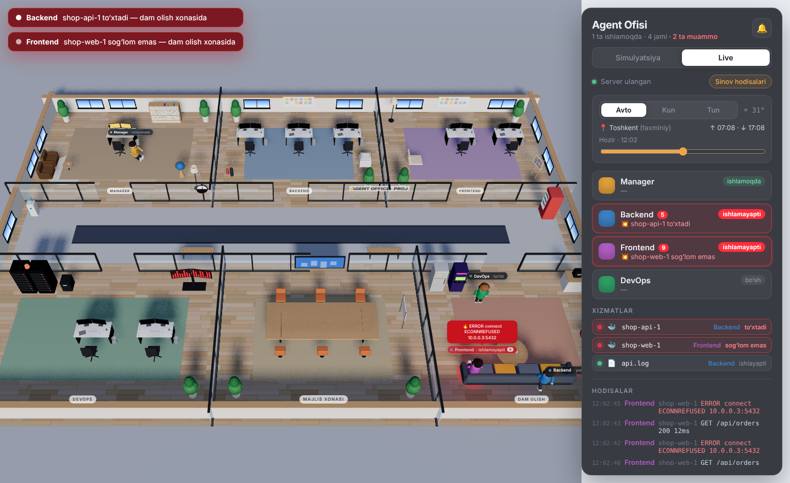

<div align="center">


# Agent Office 3D

**A Claude Code plugin that gives every sub-agent a desk in a 3D office.**
Watch them work, see your containers fail, walk in and read their screens.


[Documentation](https://YOUR_GITHUB_NAME.github.io/agent-office/) · [Install](#install) · [O‘zbekcha](#ozbekcha)


</div>

## What it does

- **Every sub-agent gets a room.** When Claude delegates work, the agent walks to its desk and every `Edit`, `Bash` or `Read` shows up as a speech bubble.
- **Your project decides the team.** `/agent-office:setup` reads the repository and creates one agent per area — Flutter, backend, DevOps, QA… The building grows a furnished room for each one.
- **Errors make agents panic.** A failed tool call, a stack trace in a container log or an error line in your terminal turns the agent red, flashes an alarm and spins the siren on the server rack.
- **Stopped containers send agents to the lounge.** When a Docker container exits, crash-loops or turns unhealthy, its agent sits on the sofa until the service is back.
- **Boss mode.** Press <kbd>B</kbd>, walk through the office in third person, stand at a desk and press <kbd>E</kbd> to read that agent's terminal.
- **The real sky.** Sunlight, sky colour and office lamps follow the actual sun at your location.

<table>
<tr>
<td width="50%"><br><sub>Containers down: agents wait in the lounge</sub></td>
<td width="50%"><br><sub>Boss mode: reading the backend agent's terminal</sub></td>
</tr>
<tr>
<td width="50%"><br><sub>The Flutter room, built by <code>/agent-office:setup</code></sub></td>
<td width="50%"><br><sub>Twenty minutes after the real sunset</sub></td>
</tr>
</table>

## Install

You need [Claude Code](https://claude.com/claude-code) and **Node.js 18 or newer**. Nothing else — the server uses only Node's standard library and the 3D interface ships prebuilt.

Inside Claude Code:

```
/plugin install agent-office --marketplace YOUR_GITHUB_NAME/agent-office
```

Or from your terminal:

```bash
claude plugin marketplace add YOUR_GITHUB_NAME/agent-office
claude plugin install agent-office@agent-office
```

## Quick start

1. Open Claude Code in your project:
   ```bash
   cd my-project
   claude
   ```
   The office server starts on its own when the session starts.
2. Run `/agent-office:office` — it prints the address (default `http://127.0.0.1:4777`). Open it in your browser and switch the panel to **Live**.
3. Run `/agent-office:setup` — Claude reads your project, writes the agents and the office builds their rooms.
4. Give Claude work as usual, for example *"ask the flutter agent to build the login screen"*, and watch the agent walk to its desk.

### Try it without Claude

```bash
git clone https://github.com/YOUR_GITHUB_NAME/agent-office
cd agent-office
node plugin/office/ctl.mjs start
```

Open `http://127.0.0.1:4777`. **Simulation** mode runs a pretend team with staged errors and container crashes. Type `flutter` into the "+ xodim" field to watch a new room being built. Stop it with `node plugin/office/ctl.mjs stop`.

## Commands

| Command | What it does |
|---|---|
| `/agent-office:office` | Prints the office address, starting the server if needed |
| `/agent-office:setup` | Reads the project, writes `.claude/agents/*.md` and `.agent-office.json`, builds the rooms |
| `/agent-office:office-watch <agent> <command…>` | Runs a command and streams its output to an agent |
| `/agent-office:office-stop` | Stops the server |

## Boss mode

| Key | Action |
|---|---|
| <kbd>B</kbd> | Enter boss mode (you appear next to the entrance) |
| <kbd>W</kbd> <kbd>A</kbd> <kbd>S</kbd> <kbd>D</kbd> / arrows | Walk, relative to the camera |
| <kbd>Shift</kbd> | Run |
| Mouse drag / wheel | Turn and zoom the camera |
| <kbd>E</kbd> | Open the monitor you're standing at |
| <kbd>Esc</kbd> | Close the monitor, then leave boss mode |

Every desk's monitor shows its agent's latest log lines and turns red when the agent panics. The DevOps monitoring wall lists every service; the meeting-room screen shows the whole event feed. Agents greet you as you pass — the ones in trouble tell you what broke. Boss mode needs a keyboard.

## What the office watches

### Claude Code

Hooks report prompts, tool calls and sub-agents: `SessionStart`, `UserPromptSubmit`, `PreToolUse`, `PostToolUse`, `PostToolUseFailure`, `SubagentStart`, `SubagentStop`, `Stop`, `StopFailure`, `SessionEnd`. The hook script waits at most about a second and always exits successfully, so Claude is never slowed down — even when the office is closed.

### Docker

If `docker` is on your `PATH`, every container that runs while the office is open is tracked and its logs are followed. A container belongs to an agent by, in order:

1. `containers` in `.agent-office.json` (a compose service name like `api` also matches `shop-api-1`)
2. a role name inside the container name (`shop-flutter-web` → `flutter`)
3. its kind (`api`, `db`, `worker` → backend · `web`, `next` → frontend · `nginx`, `redis`, `grafana` → devops)

No Docker? Everything else keeps working.

### Terminal commands and log files

Run a command through the wrapper — output still appears in your terminal:

```bash
node <plugin folder>/office/run.mjs --agent flutter -- flutter run
```

`/agent-office:office-watch flutter flutter run` does the same from inside Claude. Error lines make the agent panic; a non-zero exit sends it to the lounge. Log files are listed in `.agent-office.json`.

## Configuration

`.agent-office.json` in your project root is optional — `/agent-office:setup` writes it for you.

```json
{
  "team": [
    { "id": "flutter", "name": "Flutter" },
    { "id": "backend" },
    { "id": "devops" }
  ],
  "containers": { "api": "backend", "redis": "devops" },
  "ignoreContainers": [],
  "logs": [{ "path": "logs/api.log", "agent": "backend" }],
  "allContainers": false,
  "docker": true
}
```

The team comes from `team` in this file, otherwise from your project's `.claude/agents/*.md`, otherwise the three agents the plugin ships (`backend`, `frontend`, `devops`). Changes are picked up within two seconds: new roles get a room and walk in through the front door.

| Environment variable | Default | Meaning |
|---|---|---|
| `AGENT_OFFICE_PORT` | `4777` | Server port |
| `AGENT_OFFICE_AUTOSTART` | `1` | Set to `0` to stop the server starting with each session |
| `AGENT_OFFICE_DEBUG` | — | Print every event the server receives |

### Location and the sky

The office asks the browser for your location; if you decline it uses your IP's city ([ipapi.co](https://ipapi.co), [ipwho.is](https://ipwho.is)). Sunrise and sunset come from [sunrise-sunset.org](https://sunrise-sunset.org/api), and the sun's height is computed locally every 30 seconds. Pick **Kun** (day) or **Tun** (night) in the panel and no location is used at all. Nothing else leaves your machine.

## Troubleshooting

**The panel says "Server topilmadi" (server not found).**
Run `/agent-office:office` in Claude, or `node plugin/office/ctl.mjs start` in the repository folder. Server output is in your temp folder: `agent-office-4777/server.log`.

**`Cannot find module …ctl.mjs`.**
Check the path is relative to where you are. Inside the repository folder it's `node plugin/office/ctl.mjs start` (on Windows `node plugin\office\ctl.mjs start`).

**A console window flashes every few seconds on Windows.**
Fixed in 1.1.1. Stop the old server (`node plugin\office\ctl.mjs stop`), then reinstall the plugin:
```
claude plugin uninstall agent-office@agent-office
claude plugin marketplace update agent-office
claude plugin install agent-office@agent-office
```

**Port 4777 is taken.**
Set `AGENT_OFFICE_PORT` to another port before starting Claude.

**A container is mapped to the wrong agent.**
Add it to `containers` in `.agent-office.json`.

## How it works

```
Claude Code hooks ──┐
docker ps / logs ───┼──> plugin/office/server.mjs (127.0.0.1:4777) ──SSE──> 3D office in your browser
run.mjs, log files ─┘
```

```
app/      React + Three.js (React Three Fiber) source of the office
plugin/   the Claude Code plugin: hooks, agents, commands, server and the built UI
docs/     documentation site (GitHub Pages) and screenshots
```

## Develop

```bash
cd app
npm install
npm run dev                         # interface with hot reload at http://localhost:5173
node ../plugin/office/server.mjs    # in a second terminal
npm run build                       # writes the production interface to plugin/ui — commit it
claude plugin validate ../plugin
```

Load your working copy without a marketplace: `claude --plugin-dir ./plugin`.

To publish the documentation site, enable GitHub Pages: **Settings → Pages → Deploy from a branch → `main` / `/docs`**.

---

## O‘zbekcha

Claude Code uchun plugin: har bir sub-agentning 3D ofisda o‘z stoli va xonasi bor.

- **O‘rnatish:** Claude Code ichida `/plugin install agent-office --marketplace YOUR_GITHUB_NAME/agent-office`. Faqat Node.js 18+ kerak.
- **Ochish:** `/agent-office:office` — manzilni beradi (`http://127.0.0.1:4777`), brauzerda oching va panelda **Live** ni tanlang.
- **Jamoa:** `/agent-office:setup` — Claude loyihangizni o‘qib, har bir yo‘nalish uchun agent yaratadi, ofis har biriga xona quradi.
- **Nosozliklar:** xato chiqsa agent vahimaga tushadi (qizil holat, chiroq, sirena), Docker konteyneri to‘xtasa agent dam olish xonasiga ketadi.
- **Boshliq rejimi:** <kbd>B</kbd> — WASD bilan yurasiz, stol yonida <kbd>E</kbd> bosib agent terminalini o‘qiysiz.
- **Osmon:** joylashuvingizdagi haqiqiy quyoshga qarab o‘zgaradi; panelda Kun yoki Tun tanlansa, joylashuv ishlatilmaydi.
- **Claude’siz sinash:** `node plugin/office/ctl.mjs start`, keyin brauzerda Simulyatsiya rejimi.

## License

[MIT](LICENSE)
